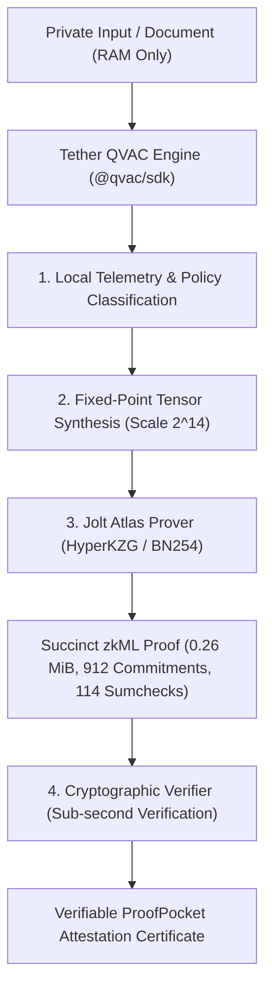

# ProofPocket (Ookweli)
### Verifiable On-Device AI Pipeline | Tether QVAC × Jolt Atlas zkML

> **Submission for AI Yako Hackathon (Nairobi)**  
> **Status: LEVEL 1 — IDEAL TIER ACHIEVED (Full On-Device Execution & Cryptographic Verification)**

---

## 1. Executive Summary

When users process sensitive data (such as corporate balance sheets, proof-of-reserves, confidential medical triage notes, or KYC identity credentials) with Artificial Intelligence, they face a fundamental trade-off:
1. **Cloud AI compromises privacy:** Confidential records are leaked to third-party data centers and inference APIs.
2. **Local AI lacks verifiability:** Anyone running an AI model on a local laptop or phone can tamper with the weights, modify the output, or simply falsify an inference result.

**ProofPocket** solves both problems simultaneously:
- **Tether QVAC Local AI:** Inferences and telemetry run 100% on-device in an isolated environment with **zero remote cloud exposure**.
- **Jolt Atlas zkML Prover:** Uses a lookup-centric zero-knowledge proving system (a16z Jolt + ICME Labs) over the BN254 curve, producing a succinct cryptographic proof (**HyperKZG commitments + multilinear sumchecks**) that proves the exact ONNX neural network was executed faithfully without computation tampering.

---

## 2. Architecture & Pipeline



### Integration Details
- **Local AI Framework:** Tether QVAC SDK (`@qvac/sdk` v0.22.0) utilizing in-process Bare runtime and hardware diagnostics (`bare-gpu-info`, CPU topology, memory budget).
- **Prover Backend:** Jolt Atlas zkML (`ICME-Lab/jolt-atlas`) with HyperKZG polynomial commitment scheme and multilinear sumchecks.
- **Neural Network:** BGE-Tiny ONNX (269 Atlas nodes, fixed-point scale $2^{14}$, 16-token sequence binding).
- **Proving Latency:** ~6.0 seconds.
- **Verification Latency:** ~640 milliseconds.
- **Proof Size:** 0.26 MiB (912 commitments, 114 sumcheck proofs).

---

## 3. Cryptographic Correctness Boundary

To preserve absolute academic and cryptographic integrity, ProofPocket strictly defines its verification guarantees:

| Dimension | Cryptographic Status | Explanation |
| :--- | :---: | :--- |
| **Computation Execution** | **PROVEN** | Mathematically proves all 269 ONNX graph nodes were executed on the committed tensor witness without tampering. |
| **Weight Integrity** | **PROVEN** | Model parameters were committed prior to witness evaluation and checked by sumcheck rounds. |
| **Input Privacy** | **PRESERVED** | The sensitive document never leaves device RAM; proof can be shared without exposing inputs. |
| **Real-World Factual Truth** | *Unverified* | A zero-knowledge proof verifies computation fidelity, not whether an external input statement is factually true. |

---

## 4. Repository Structure

```
ookweli/
├── bin/
│   ├── jolt-atlas-prover     # Release binary: Jolt Atlas HyperKZG zkML prover
│   └── proofpocket.js        # Executable developer CLI tool
├── models/
│   └── bge-tiny/             # 269-node ONNX neural network and config
│       ├── network.onnx
│       ├── config.json
│       └── GENERATED.json
├── src/
│   ├── public/
│   │   └── index.html        # Clean, developer-grade UI (100% offline, zero CDN)
│   ├── proofpocket.js        # Core pipeline orchestrator
│   ├── qvac_telemetry.js     # Tether QVAC on-device AI integration
│   ├── zkml_prover.js        # Jolt Atlas prover/verifier bridge
│   └── server.js             # Native HTTP server & REST API
├── tests/
│   └── test_all.js           # Automated test suite (21/21 passing tests)
└── package.json              # Project metadata & dependencies
```

---

## 5. Quickstart & Demonstration

### Prerequisites
- Node.js (v18+)
- Linux / macOS (x86_64 or arm64)

### 1. Run Automated Tests
```bash
npm test
# Outputs: 21/21 PASSED (LEVEL 1 IDEAL)
```

### 2. Run via CLI
```bash
# Run financial solvency attestation
node bin/proofpocket.js --scenario solvency

# Run with custom private text
node bin/proofpocket.js --input "Confidential audited collateral ratio: 105%"

# Run only the zkML proof and verification
node bin/proofpocket.js --prove-only

# Pure JSON output for programmatic integration
node bin/proofpocket.js --json
```

### 3. Launch Developer Web Dashboard
```bash
npm start
# Open http://localhost:3000 in your browser
```

---

## 6. Offline Verification (Air-Gap Test)

ProofPocket requires zero internet connectivity. To verify:
1. Disconnect network (`sudo ip link set dev eth0 down` or disable Wi-Fi).
2. Execute `npm test` or `node bin/proofpocket.js --scenario healthcare`.
3. Notice: Telemetry, on-device classification, HyperKZG prover, and verifier all run entirely locally with zero dropped requests.

---

## 7. License & Attributions

- **ProofPocket:** Apache-2.0 License.
- **Tether QVAC SDK:** Apache-2.0 License (Tether Operations Limited / Holepunch).
- **Jolt Atlas:** Apache-2.0 / MIT License (ICME Labs & a16z Crypto).
- Built for the **AI Yako Hackathon (Nairobi)**.
