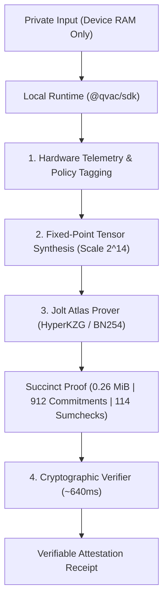

# Ookweli (`proofpocket`)

**An experimental local-first AI & zkML workbench exploring verifiable on-device inference.**

Ookweli pairs **Tether's QVAC** local runtime (`@qvac/sdk`) with **Jolt Atlas** zero-knowledge proofs (`HyperKZG` + multilinear sumchecks over `BN254`). It started as a weekend research sandbox to test whether an ordinary developer laptop can run private local inference *and* cryptographically prove that a 269-node ONNX transformer actually executed without weight tampering—all completely offline.

> **Status:** Working research prototype & developer tool (CLI + local web UI + automated test suite).

---

## Why This Exists

Running AI locally solves data privacy, but introduces a different problem: **verifiability**. If a device claims *"my local model audited this ledger / triaged this note / cleared this check,"* a third party has no way to know whether the model actually ran or if the output was hardcoded.

Ookweli is a small, self-contained experiment in combining two layers:
1. **Local Execution (`@qvac/sdk`):** Isolates document inspection, hardware telemetry, and policy tagging in local memory via QVAC's Bare worker runtime—zero cloud calls, zero outbound bytes.
2. **Cryptographic Proof of Inference (`jolt-atlas`):** Lowers a compact ONNX model (`bge-tiny`, 269 Atlas nodes) into fixed-point arithmetic ($2^{14}$ scale) and generates a succinct **0.26 MiB** zero-knowledge proof of execution in ~6 seconds, verifiable in ~640 milliseconds.

---

## Architecture



### Observed Benchmarks (Local x86_64 Linux, 12 GB RAM)
- **Model:** `bge-tiny` ONNX (269 Atlas nodes, sequence length `16`, fixed-point scale `2^14`)
- **Polynomial Commitment Scheme:** HyperKZG over BN254 (`Blake2b` transcript)
- **Prover Setup:** ~0.9s – 1.5s
- **Proof Generation:** ~6.0s – 6.5s
- **Proof Size:** `0.26 MiB` (`912` commitments, `114` sumcheck proofs)
- **Verification Time:** ~640ms

---

## Cryptographic Scope & Honest Boundaries

A common pitfall in zkML demos is overclaiming what a proof guarantees. This project explicitly separates computation integrity from ground-truth claims:

| Property | Status | What It Actually Means |
| :--- | :---: | :--- |
| **Graph Execution** | **Proven** | All 269 ONNX nodes were evaluated deterministically on the committed witness tensor. |
| **Weight Commitment** | **Proven** | Model parameters were committed before witness evaluation and checked across 114 sumcheck rounds. |
| **Input Confidentiality** | **Preserved** | Raw text stays in local RAM; only the proof receipt and certificate metadata need to leave the device. |
| **Real-World Truth** | *Unverified* | Proving that a model ran faithfully does **not** prove that the input text is factually true in the real world. |

---

## Project Layout

```
ookweli/
├── bin/
│   ├── proofpocket.js        # CLI runner (--scenario, --input, --prove-only, --json)
│   └── jolt-atlas-prover     # Compiled release prover binary (built via scripts/build_prover.sh)
├── models/
│   └── bge-tiny/             # Checked-in 269-node ONNX model & metadata
│       ├── network.onnx
│       ├── config.json
│       └── GENERATED.json
├── scripts/
│   └── build_prover.sh       # Reproducible Rust release build for jolt-atlas-prover
├── src/
│   ├── public/index.html     # Zero-dependency developer dashboard (no external CDNs)
│   ├── proofpocket.js        # Pipeline orchestrator & preset scenarios
│   ├── qvac_telemetry.js     # @qvac/sdk hardware diagnostics & local text analyzer
│   ├── zkml_prover.js        # Subprocess bridge & receipt parser for Jolt Atlas
│   └── server.js             # Native Node.js HTTP server & REST API
└── tests/
    └── test_all.js           # 21-assertion end-to-end verification suite
```

---

## Quickstart

### Prerequisites
- **Node.js** v18+
- **Linux** or **macOS** (`x86_64` / `arm64`)
- **Rust toolchain** (only required if compiling `bin/jolt-atlas-prover` from source)

### Setup
```bash
git clone https://github.com/Kim8584/ookweli.ai.git
cd ookweli.ai
npm install

# Compile the release Jolt Atlas prover binary (if not already present in bin/)
./scripts/build_prover.sh
```

### Run the Test Suite
```bash
npm test
```
Runs 21 checks across QVAC Bare worker initialization, local document fingerprinting, Jolt Atlas proof generation/verification, and error boundaries.

### Run the CLI
```bash
# Run a preset scenario (solvency | healthcare | identity)
node bin/proofpocket.js --scenario solvency

# Run with custom local text
node bin/proofpocket.js --input "Audited collateral ratio: 105%"

# Run only the Jolt Atlas zkML prover + verifier
node bin/proofpocket.js --prove-only

# Emit machine-readable JSON
node bin/proofpocket.js --json
```

### Launch the Local Web UI
```bash
npm start
# Open http://localhost:3000
```

---

## Air-Gap / Offline Verification

Once `npm install` and `./scripts/build_prover.sh` have completed, the entire stack operates with zero network access. You can disable Wi-Fi or unplug Ethernet and run `npm test`, `npm start`, or `node bin/proofpocket.js`—all inference, telemetry, proving, and verification execute locally.

---

## License & Credits

- **Ookweli / ProofPocket:** Apache-2.0
- **Tether QVAC SDK (`@qvac/sdk`):** Apache-2.0
- **Jolt Atlas (`ICME-Lab/jolt-atlas`):** Apache-2.0 / MIT (built on a16z Crypto's Jolt)
- **BGE-Tiny ONNX fixture:** MIT
